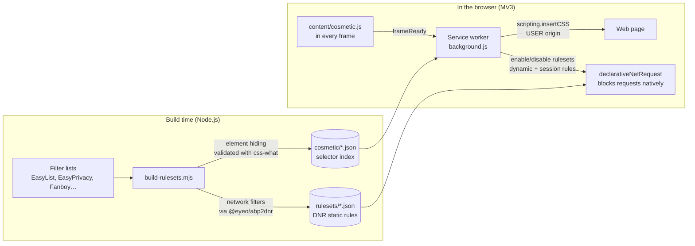

<div align="center">


# AdBye

**A free, open source ad blocker with every "premium" feature included.**<br>
No accounts. No sign-ups. No licenses. No AdBye servers. Install it and it works.

[](LICENSE)


</div>

---

## Why AdBye?

Popular ad blockers keep their best features behind a subscription: cookie banner blocking, distraction control, image swap, themes, sync. They also tie those features to an online account that is checked against the vendor's servers.

AdBye takes a different approach:

- **Everything is free.** Every feature is on from day one. There is no "Pro" tier and no feature flag waiting for a payment.
- **No accounts, anywhere.** There's nothing to sign up for or log into, and no license check. AdBye has no backend at all.
- **No "acceptable ads".** Ads are blocked, full stop. No allowlisting deals.
- **Open source.** GPL-3.0, built only on open filter lists.

AdBye is an independent implementation. It contains no AdBlock code, proprietary filter lists, images or trademarks, and is not affiliated with AdBlock, eyeo or Adblock Plus.

## Features

| Feature | AdBlock | AdBye |
|---|:---:|:---:|
| Ad blocking (EasyList + regional lists) | Free | ✅ Free |
| Tracker blocking (EasyPrivacy) | Free | ✅ Free |
| Cryptominer blocking | Free | ✅ Free (NoCoin) |
| Allowlist; pause per site, per tab or everywhere | Free | ✅ Free |
| Element picker ("block an element") | Free | ✅ Free |
| Allow ads on chosen YouTube channels | Free | ✅ Free |
| Custom filters and custom filter list URLs | Free | ✅ Free |
| **Distraction Control** (pop-ups, newsletters, surveys, floating videos) | 💰 Premium | ✅ Free |
| **Cookie consent banner blocking** | 💰 Premium | ✅ Free |
| **Deny push notification prompts** | 💰 Premium | ✅ Free |
| **Image Swap** (replace ads with cats, dogs, landscapes or your own pictures) | 💰 Premium | ✅ Free |
| **Color themes** for the popup and options page | 💰 Premium | ✅ Free (7 themes) |
| **Sync and backups** | 💰 Premium + account | ✅ Free, no account |
| Blocking statistics | Free | ✅ Free, with a 30-day chart |
| Account required for premium features | Yes | **Never** |
| "Acceptable Ads" on by default | Yes | **Doesn't exist** |

## Installation

AdBye isn't in the browser stores yet, so you load it as an unpacked extension. It takes a minute and needs no build step: the compiled filter lists are committed to the repo.

1. Get the code:
   ```bash
   git clone https://github.com/oskarko/Adbye.git
   ```
   You can also click **Code → Download ZIP** and unzip it.
2. Open your browser's extensions page:

   | Browser | Address |
   |---|---|
   | Google Chrome | `chrome://extensions` |
   | Microsoft Edge | `edge://extensions` |
   | Brave | `brave://extensions` |

3. Turn on **Developer mode**. In Chrome and Brave the switch is at the top right; in Edge it's in the left sidebar.
4. Click **Load unpacked** and select the **`extension`** folder inside the repo (not the repo root).
5. Pin AdBye from the puzzle-piece menu so its icon is always visible.

That's it. Blocking starts immediately with sensible defaults, and the regional list for your browser language is turned on automatically.

> **Brave users:** Brave Shields also block ads. To see what AdBye does on its own, turn Shields off for the site you're testing.

To update, run `git pull`, then click the reload button ↻ on AdBye's card in the extensions page.

### Firefox

AdBye runs on Firefox 140 or newer, from the same `extension` folder.

1. Open `about:debugging#/runtime/this-firefox`.
2. Click **Load Temporary Add-on…** and select **`extension/manifest.json`**.
3. Pin AdBye from the puzzle-piece menu.

Firefox removes temporary add-ons when it closes, so you load it again after each restart. A permanent install needs a copy signed by Mozilla, which is how every Firefox add-on is distributed; you still won't need an account to use AdBye.

If the popup says AdBye can't access websites, click **Allow access to all websites**. Firefox lets you withdraw site access from an extension at any time, and without it AdBye can't block anything.

## Using AdBye

### The popup

Click the AdBye icon to see:

- **Status** for the current site: active, allowlisted, paused, and so on.
- **Counters** for items blocked on this page and in total. The toolbar badge shows the per-page count.
- **Block an ad on this page:** opens the element picker.
- **Toggles:**
  - **Don't block on this site:** adds the site to the allowlist.
  - **Pause on this tab:** pauses blocking until the tab is closed.
  - **Allow ads on @channel:** only shown on YouTube.
  - **Swap ads for pictures:** turns Image Swap on or off.
  - **Pause AdBye everywhere.**
- **Options:** opens the full settings page.

Changing a toggle reloads the tab so the change takes effect right away.

### Blocking an element by hand

Use the picker when a list misses something. Click **Block an ad on this page** in the popup, or right-click the element and choose **Block this element**.

1. Hover over the page; the element under the cursor is highlighted.
2. Click to select it.
3. Use the **Selection size** slider to make the selector more or less specific. The picker shows how many elements on the page match.
4. Click **Block it**. Press Esc at any time to cancel.

The element is hidden at once, and a filter like `example.com##.sidebar-promo` is saved to your custom filters. You can edit or remove it later in **Options → Customize**.

### YouTube channels

To support a creator, open one of their videos and turn on **Allow ads on @channel** in the popup. Ads are allowed only on that channel's videos. The list of allowed channels is in **Options → Customize**.

### Image Swap

Image Swap replaces hidden ad slots with pictures. Pick a channel in **Options → Image Swap**:

| Channel | Source |
|---|---|
| Cats | [cataas.com](https://cataas.com) |
| Dogs | [Dog CEO API](https://dog.ceo/dog-api/) |
| Landscapes | [Lorem Picsum](https://picsum.photos) |
| Black & white | [Lorem Picsum](https://picsum.photos) (grayscale) |
| Your pictures | Images you upload, scaled to 800 px and stored only in your browser |

Pictures appear only in slots of at least 60 × 40 px. They're drawn inside a shadow DOM, so page styles can't break them.

### Options page

| Section | What you can do |
|---|---|
| **General** | Show or hide the badge number and the right-click menu; deny notification prompts on every site. |
| **Filter lists** | Turn each bundled list on or off, with rule counts per list; add any Adblock Plus list by URL (refreshed every 24 hours, or **Update now**). |
| **Customize** | Edit allowed sites (subdomains included), allowed YouTube channels and your own filters. Invalid lines are reported. |
| **Image Swap** | Choose a picture channel or upload your own pictures. |
| **Themes** | Pick separate themes for the popup and the options page: Automatic (follows the system), Dark, Solarized, Solarized light, Watermelon, Sunshine, Ocean. |
| **Backup & sync** | Export or import all settings as a JSON file. Optionally sync through your browser's built-in sync. |
| **Statistics** | Blocks per day over 30 days, top blocked domains, and a reset button. |
| **About** | Version, filter list credits and license. |

### Writing custom filters

AdBye understands [Adblock Plus filter syntax](https://help.adblockplus.org/hc/en-us/articles/360062733293), one filter per line:

```adblock
! Lines starting with ! are comments

! Block requests to a domain and its subdomains
||ads.example.com^

! Block an image path, but only for third-party requests
/banners/*.gif$image,third-party

! Exception: never block this
@@||example.com/ads/required-script.js

! Hide elements everywhere, or only on some sites
##.sponsored-post
news.example.com##div[id^="promo-"]

! Undo a hiding rule on one site
example.org#@#.sponsored-post
```

Network filters become `declarativeNetRequest` rules, and element hiding filters become injected CSS. Procedural filters (`#?#`) and snippets (`#$#`) aren't supported; see [Limitations](#limitations).

### Sync without an account

Sync is optional. AdBye stores settings with `chrome.storage.sync`, so they travel with whatever sync your browser already uses (Google, Microsoft or Brave). AdBye never sees or needs any of it, and if your browser isn't signed in, settings simply stay on that device. To move settings anywhere manually, use **Export backup** and **Import backup**.

## Privacy

AdBye collects nothing and has no servers. Statistics are computed and stored only in your browser.

It connects to the internet only:

- **when you add a custom filter list URL**, to download that list every 24 hours;
- **when Image Swap is on**, to load pictures from the service of the channel you chose.

The bundled filter lists ship inside the extension, so AdBye doesn't phone home for them.

## How it works



### Network blocking

Manifest V3 extensions can't inspect requests in JavaScript. Instead, the browser applies declarative rules natively, which is fast and private.

- **Static rulesets.** Each filter list is compiled at build time into its own static ruleset, about 27,000 rules in total (about 18,800 with the default lists). Turning a list on or off only enables or disables its ruleset; nothing is parsed at runtime.
- **Merged domain rules.** Most filters are plain `||example.com^` blocks. The build merges those that share the same options into one rule with a `requestDomains` list, which turns about 136,000 rules into 27,000 without changing what gets blocked. This keeps every list within Firefox's limit of 30,000 static rules per extension. Large lists are also split into rulesets under 4 MB (`easylist`, `easylist__2`, …), since Mozilla's add-on store rejects bigger files.
- **Dynamic rules.** Custom filters, custom list URLs and the allowlist are compiled to dynamic rules when they change. If one rule is rejected, AdBye adds the rest one by one so a single bad line can't disable everything.
- **Session rules.** Pausing a tab and allowing a YouTube channel use tab-scoped `allowAllRequests` rules, which disappear when the browser closes.

### Element hiding

When a frame loads, `content/cosmetic.js` tells the service worker. The service worker:

1. collects the generic selectors plus the domain-specific ones for that frame from the enabled lists' cosmetic indexes;
2. removes any that are excepted with `#@#`;
3. injects them with `chrome.scripting.insertCSS` using the `USER` origin, so `display: none !important` beats even inline styles.

When Image Swap is on, ad slots in the top frame are hidden with `visibility: hidden` instead, which keeps their size so a picture can take their place.

### Notification blocking

`content/no-notifications.js` runs in the page's own JavaScript world (`world: "MAIN"`) at `document_start`. It makes `Notification.permission` report `"denied"` and makes `requestPermission()` and `PushManager.subscribe()` refuse, so sites never get to show the prompt.

### Statistics

The browser reports requests blocked by `declarativeNetRequest` as errors: `net::ERR_BLOCKED_BY_CLIENT` in Chromium and `NS_ERROR_ABORT` in Firefox. AdBye counts those through `webRequest.onErrorOccurred`, which observes but never blocks, together with the number of elements hidden on each page. Counts are kept per tab, per day (30 days) and per domain.

## Bundled filter lists

| List | Category | On by default | Network filters | Hiding rules | License |
|---|---|:---:|---:|---:|---|
| EasyList | Ads | ✅ | 55,693 | 24,363 | GPL-3.0 / CC BY-SA 3.0 |
| ABP Anti-Circumvention | Ads | ✅ | 2,026 | 454 | GPL-3.0 / CC BY-SA 3.0 |
| EasyPrivacy | Privacy | ✅ | 56,289 | 2 | GPL-3.0 / CC BY-SA 3.0 |
| Fanboy's Social Blocking List | Privacy | | 656 | 13,163 | GPL-3.0 / CC BY-SA 3.0 |
| EasyList Cookie List | Cookie banners | ✅ | 2,104 | 23,153 | GPL-3.0 / CC BY-SA 3.0 |
| Fanboy's Annoyance List | Distractions | ✅ | 4,138 | 46,067 | GPL-3.0 / CC BY-SA 3.0 |
| Fanboy's Notifications Blocking List | Distractions | ✅ | 405 | 948 | GPL-3.0 / CC BY-SA 3.0 |
| NoCoin | Security | ✅ | 311 | 0 | MIT |
| EasyList Spanish | Language (es) | auto | 625 | 1,920 | GPL-3.0 / CC BY-SA 3.0 |
| EasyList Germany | Language (de) | auto | 2,191 | 3,577 | GPL-3.0 / CC BY-SA 3.0 |
| Liste FR | Language (fr) | auto | 9,765 | 3,444 | GPL-3.0 |
| EasyList Italy | Language (it) | auto | 1,134 | 3,028 | GPL-3.0 / CC BY-SA 3.0 |
| EasyList Portuguese | Language (pt) | auto | 303 | 1,316 | GPL-3.0 / CC BY-SA 3.0 |
| EasyList Dutch | Language (nl) | auto | 469 | 1,020 | GPL-3.0 / CC BY-SA 3.0 |

"auto" means the list is turned on at install when it matches the browser language. Counts are filters, before domain rules are merged, from the build of October 2026; they change with each rebuild.

## How AdBye was built

### 1. Research

AdBye began as a study of how the AdBlock extension (version 6.x, Chrome Web Store ID `gighmmpiobklfepjocnamgkkbiglidom`) works. The installed extension was analyzed with [REA](https://github.com/morluto/rea), a reverse-engineering toolkit, using its JavaScript application analysis together with the source maps the extension itself ships. The findings that shaped AdBye:

- **AdBlock is GPL-3.0** and built on eyeo's `@eyeo/webext-ad-filtering-solution`, the same engine as Adblock Plus.
- **Premium is a license check, not a technical limit.** Premium features are unlocked by `License.isActiveLicense()`, which asks AdBlock's servers about your account. When the license expires, `processExpiredLicense` turns Image Swap off, resets themes and removes the Distraction Control and cookie lists. The features themselves are ordinary code.
- **The Premium filter lists are proprietary** (`adblock_premium.txt`, `distraction-control-*.txt`, `cookie-filter-list.txt`).

### 2. Design decisions

- **Rebuild, don't patch.** Instead of removing a license check from someone else's product, AdBye reimplements every feature from scratch with no license logic at all, and uses no AdBlock code, assets or brand.
- **Open lists only.** The proprietary Premium lists are replaced with open, community-maintained equivalents: Fanboy's Annoyance, Cookie and Notifications lists.
- **Do the work at build time.** Filter lists are compiled to native `declarativeNetRequest` rulesets before shipping. The extension never parses tens of thousands of filters on your machine, which keeps it fast and the service worker small.
- **Zero runtime dependencies and no bundler.** The extension is plain ES modules, HTML and CSS that the browser loads directly. What's in `extension/` is exactly what runs, which makes it easy to audit.
- **No accounts, no backend.** Sync uses the browser's own storage sync, and backups are local files.

### 3. Tools and technologies

| Area | Used |
|---|---|
| Platform | WebExtensions Manifest V3 (Chromium and Firefox): `declarativeNetRequest`, `scripting`, `storage`, `contextMenus`, `webRequest` (observe only), `webNavigation` |
| Language | Modern JavaScript (ES modules), HTML, CSS custom properties for theming |
| Filter compilation | [`@eyeo/abp2dnr`](https://www.npmjs.com/package/@eyeo/abp2dnr) (GPL-3.0), which converts Adblock Plus filters to DNR rules |
| Selector validation | [`css-what`](https://github.com/fb55/css-what), which drops hiding rules the browser couldn't parse |
| Icons | Generated by a small dependency-free PNG writer (`scripts/make-icons.mjs`) |
| Tests | Node's built-in test runner (`node --test`) |
| Localization | `chrome.i18n` with English and Spanish |
| CI | GitHub Actions, which rebuilds the filter lists weekly and opens a pull request |
| Research | [REA](https://github.com/morluto/rea) |
| Development | Written with [Claude Code](https://claude.com/claude-code) |

### 4. Verification

Besides unit tests for the filter parser, the extension was tested end to end in headless Microsoft Edge and Brave, driven over the Chrome DevTools Protocol, and in headless Firefox, driven through geckodriver. Those tests checked that:

- rulesets load;
- ad requests are blocked and ad elements hidden;
- custom filters apply;
- notification permission reports `denied`;
- Image Swap inserts pictures;
- the allowlist restores a site;
- statistics count blocked requests.

## Development

### Requirements

- Node.js 22 or newer
- `zip`, only for `npm run package`

### Commands

```bash
npm install                  # build-time dependencies only
npm run build:lists          # download the lists → extension/rulesets + extension/cosmetic
npm run build:lists:offline  # rebuild from the copies cached in .cache/
npm test                     # unit tests
npm run build:icons          # regenerate the PNG icons
npm run package              # create dist/adbye-<version>.zip for store submission
```

`build:lists` also rewrites the `rule_resources` section of `manifest.json`, so adding a list is just a new entry in `extension/lists.json` followed by a rebuild.

During development, load `extension/` unpacked. After editing code, click ↻ on the extension card and reload the page. Use the **service worker** link on the card to open the background console.

### Project layout

```
extension/                    the extension, loaded as is
├── manifest.json
├── lists.json                catalog of bundled filter lists
├── background.js             service worker: setup, messages, context menu, YouTube, Image Swap
├── lib/
│   ├── filters.js            ABP filter parser, shared by the build script and the extension
│   ├── engine.js             applies DNR rulesets, dynamic and session rules, and hiding CSS
│   ├── settings.js           settings and defaults
│   ├── stats.js              counters, badge and history
│   └── sync.js               browser storage sync and JSON backups
├── content/
│   ├── cosmetic.js           requests hiding CSS for each frame; Image Swap
│   ├── picker.js             element picker overlay
│   ├── youtube.js            detects the current YouTube channel
│   └── no-notifications.js   denies notification and push permission (MAIN world)
├── popup/  options/  shared/ UI, themes and helpers
├── _locales/{en,es}/         translations
├── rulesets/  cosmetic/      generated by build:lists (committed)
└── icons/
scripts/
├── build-rulesets.mjs        filter lists → DNR rulesets + cosmetic indexes
├── make-icons.mjs
└── package.mjs
test/                         node --test unit tests
.github/workflows/lists.yml   weekly filter list rebuild
```

### Adding a translation

Copy `extension/_locales/en/messages.json` to `extension/_locales/<lang>/messages.json` and translate the `message` values. Keep the keys and `$P1$`-style placeholders unchanged.

## Limitations

- **Bundled lists update with releases.** MV3 static rulesets can't be refreshed by downloading. A weekly CI job rebuilds them, but users get new rules when they update AdBye. Custom lists added by URL do refresh every 24 hours.
- **No procedural filters or snippets.** Adblock Plus `#?#` and `#$#` filters need script injection that AdBye doesn't implement yet; the build drops them. This mostly affects ads that YouTube injects through scripts.
- **Image Swap and strict sites.** Sites with a strict Content Security Policy block external images; on those sites the ad is just hidden.
- **YouTube channel detection** reads YouTube's page structure and may need fixes when YouTube changes it.
- **No Safari yet.** Safari needs the extension wrapped in a native app built with Xcode.
- **Firefox needs re-loading after a restart** until AdBye is signed by Mozilla; see [Firefox](#firefox).

## Contributing

Issues and pull requests are welcome. Please:

- keep the extension free of runtime dependencies and bundlers;
- run `npm test` before opening a PR;
- add UI strings to both `en` and `es` locales;
- never add anything that needs an account, a server or a payment.

## License and credits

AdBye is free software under the [GNU General Public License v3.0](LICENSE).

The filter lists are the work of their maintainers and keep their own licenses:

- [EasyList, EasyPrivacy and the Fanboy lists](https://easylist.to/): GPL-3.0 / CC BY-SA 3.0
- [Liste FR](https://forums.lanik.us/): GPL-3.0
- [ABP Anti-Circumvention](https://github.com/abp-filters/abp-filters-anti-cv): GPL-3.0 / CC BY-SA 3.0
- [NoCoin](https://github.com/hoshsadiq/adblock-nocoin-list): MIT

Build tools: [@eyeo/abp2dnr](https://www.npmjs.com/package/@eyeo/abp2dnr) (GPL-3.0) and [css-what](https://github.com/fb55/css-what) (BSD-2-Clause).

Image Swap pictures come from [cataas.com](https://cataas.com), the [Dog CEO API](https://dog.ceo/dog-api/) and [Lorem Picsum](https://picsum.photos).

AdBlock is a trademark of its owner. AdBye is not affiliated with, endorsed by or connected to AdBlock, eyeo GmbH or Adblock Plus.
